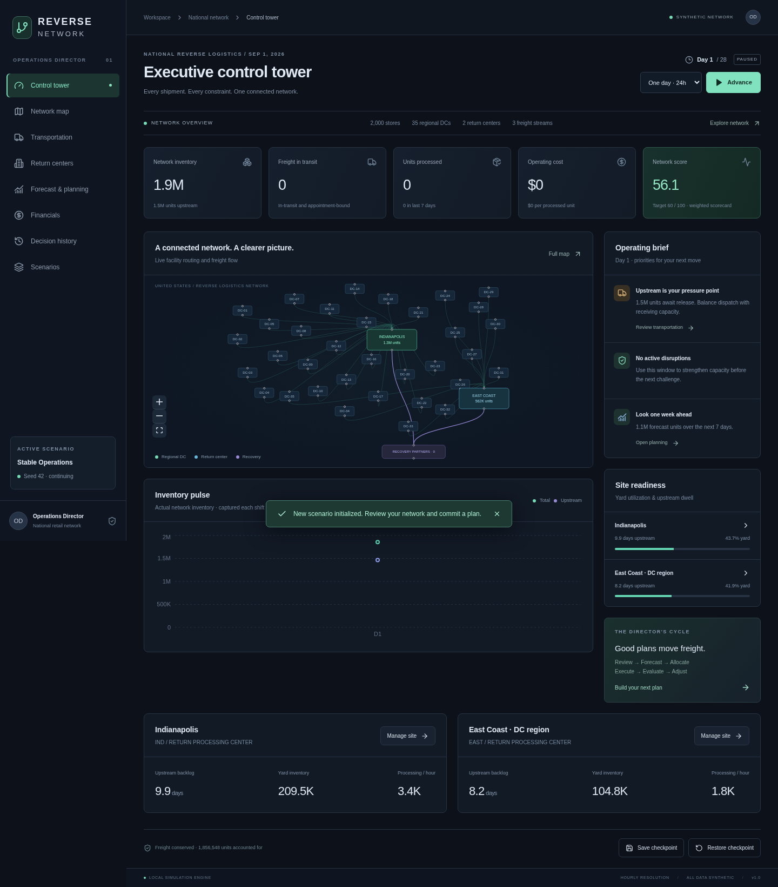

# Reverse Network: Operations Director

A playable, local browser game about running a national reverse logistics network. Inherit 2,000 synthetic stores, 35 regional DCs, Indianapolis and East Coast return centers, and a substantial backlog. Make a plan, preview its consequences, commit it, and execute hourly operations a shift, day, or week at a time.

## Install and start

Requires Python 3.12+, Node 22+, and npm. No paid services, keys, or external database are required.

```bash
bash scripts/setup.sh
bash scripts/start.sh
```

Open `http://localhost:5173` in a local browser. The FastAPI service uses port 8000; Vite proxies `/api` to it. Swagger documentation is at `http://localhost:8000/docs`. Stop both services with Ctrl+C. If running separately, use these from the repository root:

```bash
.venv/bin/python -m uvicorn backend.main:app --host 0.0.0.0 --port 8000
npm --prefix frontend run dev -- --host 0.0.0.0
```

Dependencies and frontend lockfile are included. Setup uses `npm ci`; npm's cache lives in `/tmp/reverse-npm-cache` for compatibility with restricted home directories. SQLite is initialized automatically in ignored `data/games.db`. Set `DATABASE_URL` to use another SQLAlchemy-supported database (install its driver separately). The application is intended for local, single-operator use; it has no authentication and should not be exposed publicly as a shared production service.

## How to play

1. Choose **Scenarios**, a seed, and Standard or Hard difficulty. Start Stable Operations to learn.
2. Review the control tower: inventory, upstream pressure, transit, costs, and score. The map shows DC routing and downstream recovery. Select a DC to inspect its store IDs and live aggregate inventory.
3. Open **Return centers** or **Transportation**, then edit a site's operating plan. Reallocate a fixed worker roster among receiving, warehouse, and processing. Add overtime or temporary labor, change dispatch and appointments, choose carriers, prioritize a freight stream, hold releases, expedite, buy extra transport, reroute a DC, or invest in equipment.
4. **Preview 24 hours** compares the proposed plan with the current plan on independent copies of the simulation. Nothing changes until **Commit plan**. The preview uses the same random seed and exposes an estimate of the next day's outcomes. Previewing does not spend money or advance the clock.
5. **Advance** one shift (8h), one day (24h), or one week (168h). Every hour is executed. Watch inventory accumulate behind bottlenecks, shipments move, disruptions clear, and recovery value accrue.
6. Use forecasts to prepare for seasonal surges. A demand override changes your forecast assumption only; it cannot remove actual freight.
7. Progress autosaves after commands. **Save checkpoint** captures an explicit recovery point. **Restore checkpoint** restores its complete state, including random state. Load existing games from Scenarios. Start a fresh game with the same seed to replay.
8. Finish 28 days at or above 60 points to win. Excessive network inventory (over 40 seasonal demand-days) ends a game early. The final banner reports your outcome; Financials explains score weights, formulas, and targets.

### Four challenges

- **Stable Operations:** learn the tradeoffs in an established network.
- **Transportation Crisis:** carrier acceptance is halved; appointment capacity is reduced.
- **Peak Season:** December demand doubles, rising to 4.455 million weekly during Christmas and the following week.
- **Facility Breakdown:** Indianapolis processing equipment starts at 55% effectiveness.

Each challenge runs for 28 days. Hard difficulty adds 10% actual demand. All scenarios use the same explicit score target and failure criteria, allowing deterministic comparisons. The baseline controller is a demonstration, not an optimal player and is not guaranteed to win.

## Simulation

The pure Python engine in `simulation/engine.py` executes a fixed hourly discrete-event sequence. SimPy is intentionally unnecessary for a fixed-hour time model. Category-specific aggregate lots retain origin, age, assigned site, units, and state:

`upstream → tender response → pickup → transit/appointment wait → yard → receiving → staging → disposition`

Carrier rejection returns a lot to upstream; accepted freight waits for a pickup before departing. Loads never exceed 2,400 units. Daily release limits, reusable trailer pools, transit, hourly appointments, yard capacity, and department buffers all constrain flow. Trailer slots remain occupied through tender, pickup, transit, and yard until unloading. Separate receiving, warehouse, and processing budgets prevent increased dispatch or processing labor from bypassing other bottlenecks. Mail-in freight consumes 1.8× processing effort. Processing creates liquidation, recycling, and recovery outcomes; all freight reaches the center before disposition.

Hourly assertions check conservation, positive quantities, unique lot IDs, load size, arrival ordering, nonnegative costs, yard/buffer limits, and disposition totals. Random state persists through save/load. Events affect acceptance, trailers, appointments, productivity, attendance, or generated demand and have explicit start/end, factor, and impacted site. Completed event records remain visible.

`scenarios/defaults.json` contains synthetic volume, category mix, high/low-value proportions, recovery rates, staffing, productivity, labor rates, effective shift/break hours, capacities, trailer pools, delays, carrier terms, seasonality, monthly DC removal pulses, event assumptions, score weights/targets, and horizon. `scenarios/scenarios.json` defines scenario modifiers. The initial stock includes aged upstream inventory and two days of yard stock. Generation uses regional aggregates and seeded hourly variation. Forecasts estimate **new demand**, not guaranteed dock arrivals.

Transport, regular labor, overtime, dwell/storage, and equipment investment are charged separately. Recovery is recognized only when processing completes. Financial score uses cumulative costs per processed unit, including cost of holding inherited inventory. Labor score compares cumulative work effort with cumulative available processing capacity, so plan changes do not retroactively rewrite the denominator. See Financials for the full formulas.

## Tests and agent

### Simulated players

Four deterministic players can run full games without opening the browser:
`hands_off` keeps the default plan, `baseline` uses the original controller,
`cost_conscious` avoids overtime and investment, and `adaptive_throughput`
reallocates workers and responds to queue pressure with overtime and faster freight.
These are rule-based simulations, not live multiplayer opponents or trained models.

```bash
# Compare all four players across all scenarios and two matching seeds:
.venv/bin/python -m scripts.simulate_players
# One player, one scenario, and optional daily action traces:
.venv/bin/python -m scripts.simulate_players --players adaptive_throughput --scenarios crisis --seeds 42 --trace-dir /tmp/player-traces
# Include the harder demand setting:
.venv/bin/python -m scripts.simulate_players --difficulties standard hard
```

The runner checks freight conservation and hourly engine invariants and writes
[a comparison report](docs/player-simulation-report.md) plus
[individual episode results](docs/player-simulation-results.json).
Each player gets an independent game with the same scenario, difficulty, and seed.
Results are reproducible examples rather than a guarantee that a strategy will win.

From the repository root:

```bash
.venv/bin/python -m pytest -q
npm --prefix frontend test
npm --prefix frontend run build
# Start the application first, then run real browser gameplay:
npm --prefix frontend run e2e
# All four scenarios, seeds 42 and 137; JSONL episodes go to /tmp:
.venv/bin/python -m scripts.validate_scenarios
# One baseline agent episode:
.venv/bin/python -m simulation.agent --scenario crisis --seed 42 --output /tmp/episode.jsonl
```

Playwright uses system Chromium at `/usr/bin/chromium`; set `CHROMIUM_PATH` for a different installation. On a machine without a browser, install Chromium with the OS package manager, or run `npx playwright install chromium` in `frontend/` and adjust the executable path. Browser tests cover plan changes, preview and commit, time advance, checkpoint save/restore, reload, map inspection, history, finances, a full 28-day scenario, terminal controls, and tablet layout. They save screenshots in `/tmp/reverse-*.png` and retain traces on failure.

The API offers structured observation (`GET /api/games/{id}`), validated action, planning preview, and step endpoints. Observations expose constraints, forecasts, available actions, score, reward (overall / 100), and termination. `step` accepts an optional action so external agents can use one action/transition interface. `simulation/agent.py` uses the same action validation as humans. JSONL episodes include seed, observation, action space, chosen action, next observation, reward, and terminal outcome. No LLM or training is required.

See [architecture](docs/architecture.md), [validation report](docs/validation.md), and [complete scenario results](docs/validation-results.json).

## Release scope and next improvements

This first playable release implements the full planning/execution/evaluation loop, four scenarios, persistence, all eight navigation areas, a baseline agent, and automated validation. It uses aggregate store demand, synthetic regional positions, fixed category high-value proportions, and a daily roster translated into hourly effective capacity. Individual store IDs are inspectable; individual store transactions and SKU histories are not generated. The transportation page exposes automated tender/retry strategies and a recent arrival ledger rather than a manual per-load tender workflow. Forecasts are analytical demand/capacity estimates; preview is a seeded simulation comparison.

Further work: configurable shift calendars and breaks per worker, equipment lead times and capital budgets, carrier contract negotiation, parcel-specific networks and SKU-level processing, detailed site-by-site throughput time series, per-store transaction drilldown, forecast error tracking, user-created scenario files in the UI, side-by-side saved-run comparisons, modular frontend page files, database migrations, and deployment authentication. These are not represented as completed functionality. PostgreSQL support follows SQLAlchemy conventions but has not been integration tested.


